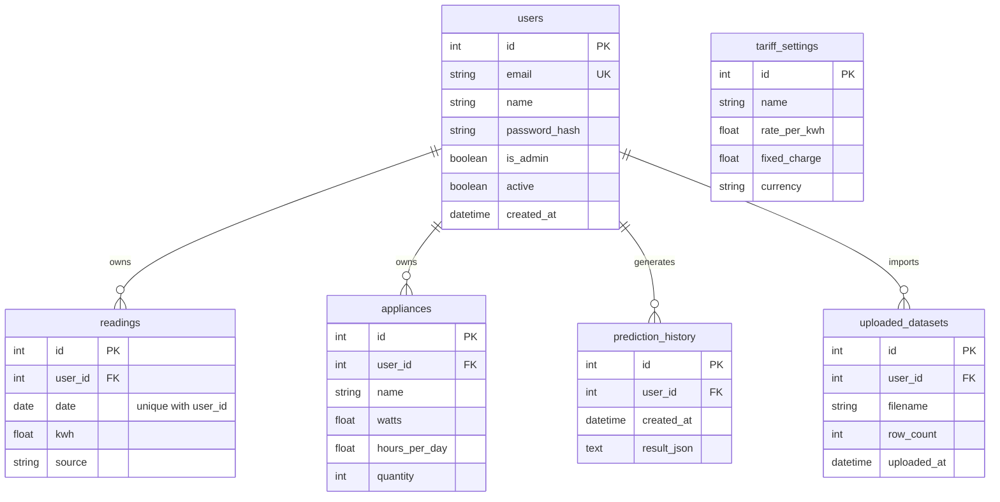

# Database schema

`schema.sql` creates six normalized MySQL tables. Alternatively, `python manage.py init-db` creates the same entities from the SQLAlchemy definitions. Use either initialization method on a fresh database, not both. Application-managed defaults populate creation timestamps and account flags; raw SQL account inserts are not supported. Registration hashes passwords.

`tariff_settings` stores a platform-wide active configuration at ID 1. It has no user foreign key because it is shared and administrator-managed. Bills use the active configuration at calculation time. Prediction history stores immutable model-output snapshots; it does not pretend to be a relational table of measured readings. Uploaded dataset metadata is retained after the raw CSV is processed and discarded.

User/date uniqueness protects against concurrent duplicate inserts. Foreign keys prevent orphan records. User data is isolated by authenticated ownership checks in the service; MySQL does not provide row-level security here. User accounts are deactivated to preserve history. Numeric database checks supplement Pydantic range and finite-value validation.
